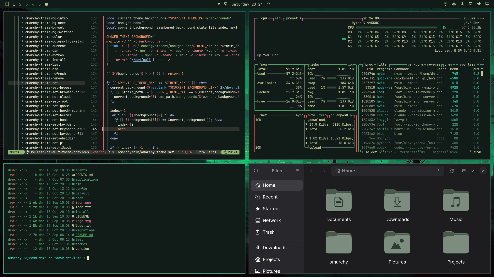

# fk-omarchy-osaka-jade-theme

> Forked from omacom/omarchy-osaka-jade-theme (MIT). See `SIGMAOS_FORK.md`.

A dark jade theme: deep green-black surfaces, a sage-green accent, warm parchment text, and sage folder icons. Osaka Jade shipped with Omarchy until it was replaced by [Jade Horse](https://github.com/dhh/omarchy-jade-horse-theme), and lives on here.



## Install

```sh
omarchy theme install https://github.com/omacom/omarchy-osaka-jade-theme
```

## Backgrounds

Three wallpapers are included, along with the Omarchy wordmark background. Cycle through them with `omarchy theme bg next`. Glowing City plays an intro when the theme is switched to.

### Glowing City


### Shaded Entrance


### Mountain Moon


## Palette

| Role | Color |
| --- | --- |
| Background | `#111c18` |
| Foreground | `#C1C497` |
| Jade accent | `#509475` |
| Selection | `#32473B` |

Omarchy generates application themes from `colors.toml`. Neovim uses [bamboo.nvim](https://github.com/ribru17/bamboo.nvim) and VS Code uses [Ocean Green](https://marketplace.visualstudio.com/items?itemName=jovejonovski.ocean-green).

Osaka Jade was created by [Justin Lowry](https://github.com/Justikun), whose original lives at [Justikun/omarchy-osaka-jade-theme](https://github.com/Justikun/omarchy-osaka-jade-theme). This is the version Omarchy shipped.

## License

MIT
